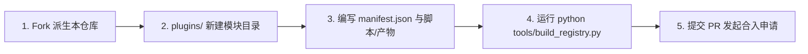

# 🌐 Multi-Toolbox 社区功能模块注册中心 (Toolbox-Community-Registry)

<p align="center">
  <b>Multi-Toolbox (多功能动态百宝箱) 官方社区功能模块与动态插件生态仓库</b>
</p>

<p align="center">
  
  
  
  
</p>

---

## 📖 仓库简介

**Toolbox-Community-Registry** 是 [Multi-Toolbox](https://github.com/SuJiuOvO/Multi-Toolbox) 的去中心化插件与功能模块托管中心。

客户端采用 **插件化微内核架构**，应用本体极其轻量（无预捆绑冗余），海量生产力工具均以声明式模块的形式在本仓库中维护与托管。用户在百宝箱客户端的「模块市场」中浏览、一键下载与热插拔安装的全部工具，均由本仓库通过自动化 CI 流程统一构建与分发。

无论您擅长 **JavaScript / TypeScript**、**C / C++ / Rust (WebAssembly)**，还是擅长 **Python / PowerShell / CLI 命令行工具开发**，都可以按照开发规范为百宝箱添加全新的实用工具，并通过提交 PR 共享给全球所有百宝箱用户！

---

## 🌟 模块运行时体系与支持范式

百宝箱底座全面支持 5 大隔离沙箱与自适应执行范式，开发者可按需选用：

| 运行时范式 | 核心技术栈 | 跨平台支持 | 适用典型场景与性能表现 |
| :--- | :--- | :---: | :--- |
| **🚀 双端自适应合一 (Dual-Adaptive)** | Win 原生 EXE + Android WASM | 🌐 双端最优解 | **旗舰推荐**：同插件兼顾 Windows 裸机原生二进制 (0.3s 直出) 与 Android WASM 沙箱 (<1s 完成) |
| **🦀 WASI VFS 算力沙箱** | C / C++ / Rust (`wasm32-wasip1`) | 🌐 Windows / Android 全兼容 | 依托 WASI Preview 1 虚拟文件系统映射 (`/input`, `/output`, `/tmp`)，流式读写百兆级文件防爆内存 |
| **⚡ QuickJS 跨平台脚本沙箱** | JavaScript (ES2020) | 🌐 Windows / Android 全兼容 | 纯文本分析、数据清洗、正则解析、轻量算法规则，免编译热插拔 |
| **🪟 Windows 独立扩展工坊** | CLI 可执行程序、PowerShell、Python | 🪟 Windows 专享 | 挂接现成大型 Windows 命令行工具（如 ffmpeg, yt-dlp, 7z），带流式终端黑框回显与进程中断 |
| **🖼️ 客户端内置算法流水线** | 客户端底层图形/音视频引擎 | 🌐 Windows / Android 全兼容 | 逆向 Alpha 混合数学去水印、FFmpeg 原生转码（支持 FLAC 无损与 OGG Vorbis 双重回退） |

---

## 🏆 官方精选模块专区 (Featured Plugins)

本仓库已托管并持续维护以下高质量精选功能模块，打开客户端「模块市场」即可一键安装使用：

| 模块名称 | 模块 ID | 架构类型 | 核心能力与技术亮点 |
| :--- | :--- | :---: | :--- |
| **网易云 NCM 解密** 🌟 | `ncm-audio-converter` | **🚀 双端自适应** | 专为网易云加密音频设计，100% 还原无损 FLAC / MP3，Windows 跑裸机原生 EXE (0.3s 直出)，Android 跑 WASM 沙箱，自动提取注入专辑封面与元数据标签 |
| **音视频工具箱 (v1.3.0)** 🎬 | `video-audio-toolbox` | **本地多媒体流水线** | 基于硬件加速 (NVENC/QSV/AMF/MediaCodec) 与多线程流转；新增 **FLAC 原生无损转码** 与 **OGG (Vorbis) 高效转码**（带原生双重回退保障） |
| **Gemini-Banana 无损去水印** 🍌 | `gemini-banana-watermark` | **本地逆向数学算法** | 纯本地逆向 Alpha 混合解算，逐像素无损恢复原图底色，拒绝涂抹模糊与 AI 虚构 |
| **万能解压与密码提取工坊** 📦 | `universal-archive-extractor` | **本地归档引擎** | 支持 7z、RAR、ZIP 分卷包自动串联、GBK 乱码探测修复与防双重嵌套展开 |
| **万能数据摘要与编解码** 🔠 | `universal-data-codec` | **QuickJS 脚本沙箱** | 支持 MD5、SHA1/256/512、Base64、Hex、URL、Unicode 批量编解码 |
| **WebAssembly 全能算力工坊** 🦀 | `universal-wasm-runner` | **Wasm 微核沙箱** | 支持直接拖拽任意 `.wasm`/`.wat` 字节码文件，自省导出表并沙箱执行 |

---

## 📚 开发者技术文档 (必读 🌟)

为方便所有开发者无障碍开发与接入功能模块，我们准备了详尽的全栈技术开发手册：

👉 **[《Multi-Toolbox 社区功能模块（插件）全栈开发与技术架构指南 (Manifest v2.2)》](docs/PLUGIN_DEVELOPMENT_GUIDE.md)**

### 手册核心内容速览：
- **五大执行模式全景解析**：手把手教您如何用 Rust 编译 `wasm32-wasip1` 虚拟文件流沙箱模块、编写 QuickJS 脚本，以及实现**双端自适应合一插件**。
- **Manifest v2.2 清单规范完整参考**：
  - **最新双端路由调度**：单个插件同时声明 `nativeRunner` 与 `wasmRunner`，客户端自动路由至双端最优底层。
  - **动态表单组件系统**：文件选择器（`file_picker`，已内置 Android 专有后缀容错与宿主层文件夹扁平化展开）、滑块（`slider`）、下拉单选（`select`）、数字框（`number`）、文本域（`text`）。
  - **动态联动条件 (`visibleIf`)**：实现复杂参数折叠与多模式切换。
  - **图标系统规范**：支持 SVG 矢量代码直接渲染、图片模式（严格限制大小 $\le$ 512KB 与像素分辨率 $\le$ 512×512）与自动平滑降级。
- **4 个完整实战项目源码**：包含从零编写、双目标交叉编译到上架全过程（含 `ncm-audio-converter` 完整解密实战范例）。
- **本地自动化校验与打包指引**。

---

## 📁 目录结构说明

```text
Toolbox-Community-Registry/
  ├── docs/
  │     └── PLUGIN_DEVELOPMENT_GUIDE.md   # 【核心】模块全栈开发与规范指南 (Manifest v2.2)
  ├── plugins/                            # 社区模块源码与清单目录
  │     ├── ncm-audio-converter/          # 网易云 NCM 解密 (双端自适应合一)
  │     │     ├── manifest.json
  │     │     ├── README.md
  │     │     └── bin/
  │     │           ├── ncmdump.exe       # Windows 原生二进制
  │     │           └── ncmdump.wasm      # WASI Preview 1 字节码
  │     ├── video-audio-toolbox/          # 音视频工具箱 (支持 FLAC / OGG)
  │     ├── gemini-banana-watermark/
  │     └── universal-wasm-runner/
  ├── packages/                           # 自动化构建输出的标准 .zip 模块包
  ├── registry/
  │     ├── index.json                    # 客户端在线拉取的多源聚合索引
  │     ├── app_version.json              # 客户端本体最新发版检测元数据
  │     └── ping.json                     # 节点连通性与测速探针
  ├── tools/
  │     └── build_registry.py             # 本地与 CI 自动化校验、打包与聚合脚本
  └── .github/workflows/
        └── build_and_sync.yml            # GitHub Actions 自动审查与同步流水线
```

---

## 🚀 如何为百宝箱贡献新功能？(快速上手)

贡献一个新工具非常简单，仅需 5 步：



### 第一步：Fork 本仓库
点击右上角 `Fork`，将本仓库派生至您的个人空间并克隆到本地。

### 第二步：添加插件目录
在 `plugins/` 目录下新建以模块 ID 命名的英文小写文件夹，例如：
```bash
mkdir plugins/my-awesome-tool
```

### 第三步：编写 `manifest.json` 与代码
根据 [Manifest v2.2 规范](docs/PLUGIN_DEVELOPMENT_GUIDE.md) 编写配置文件，并可附带 SVG 矢量代码图标或脚本：
```json
{
  "id": "my-awesome-tool",
  "name": "我的炫酷工具",
  "version": "1.0.0",
  "minAppVersion": "1.0.0",
  "category": "text",
  "platforms": ["universal"],
  "description": "详细阐述本工具的核心功能、算法特点与适用场景，支持在客户端中被深度检索。",
  "author": "您的昵称",
  "executionType": "quickjs",
  "engineType": "quickjs",
  "icon": {
    "type": "code",
    "data": "<svg xmlns="http://www.w3.org/2000/svg" viewBox="0 0 24 24"><circle cx="12" cy="12" r="10" fill="#3B82F6"/></svg>"
  },
  "inputs": [
    {
      "id": "sourceText",
      "label": "输入需要处理的文本",
      "type": "text",
      "required": true
    }
  ],
  "action": {
    "handler": "quickjs_runner",
    "params": {
      "scriptFile": "index.js"
    }
  }
}
```

### 第四步：本地一键构建与规范审查
运行内置自动化工具，验证配置格式与图标合规性：
```bash
python tools/build_registry.py
```
> 若验证无误，脚本会自动打包生成 `packages/my-awesome-tool.zip` 并更新 `registry/index.json`。

### 第五步：提交 Pull Request (PR)
将修改提交并向 `main` 分支发起 Pull Request。
- GitHub Actions 将自动触发代码合规与安全扫描。
- 审核合入后，所有百宝箱用户在打开应用时即可在「模块市场」中即时发现并一键安装您的新工具！

---

## 🌐 多源镜像加速节点

客户端默认在后台自动并发测速并选择最佳节点，若某节点被墙或限流，将自动无缝切换：

| 节点类型 | 节点名称 | 镜像地址 |
| :--- | :--- | :--- |
| **国内极速源** | Gitee 官方镜像 | `https://gitee.com/sujiuovo/toolbox-community-registry/raw/main/registry/index.json` |
| **全球加速源** | jsDelivr CDN 免梯节点 | `https://cdn.jsdelivr.net/gh/SuJiuOvO/Toolbox-Community-Registry@main/registry/index.json` |
| **官方直连源** | GitHub Raw 节点 | `https://raw.githubusercontent.com/SuJiuOvO/Toolbox-Community-Registry/main/registry/index.json` |

---

## 🔒 社区安全与合规准则

为了保护所有百宝箱用户的设备安全与个人隐私，所有提交至本仓库的模块均须遵守以下安全红线：
1. **纯本地离线执行原则**：严禁在模块内植入任何未经声明的云端数据回传、用户隐私窃取或网络嗅探行为。
2. **源码清晰无混淆**：QuickJS 脚本与自动化脚本请保持代码可读性，不得恶意混淆或加壳。
3. **大文件外链化**：单个模块源码包建议小于 10MB。若需使用体积巨大的第三方 CLI 预编译程序（如 FFmpeg），请配置 `nativeRunner.downloadUrls` 结合 SHA256 校验远程按需静默下载，切勿直接向 Git 提交数十兆的二进制。

---

## 📄 开源许可证

本项目基于 [MIT 许可证](LICENSE) 开源发布。欢迎广大开发者共同建设更好用的百宝箱生态！
