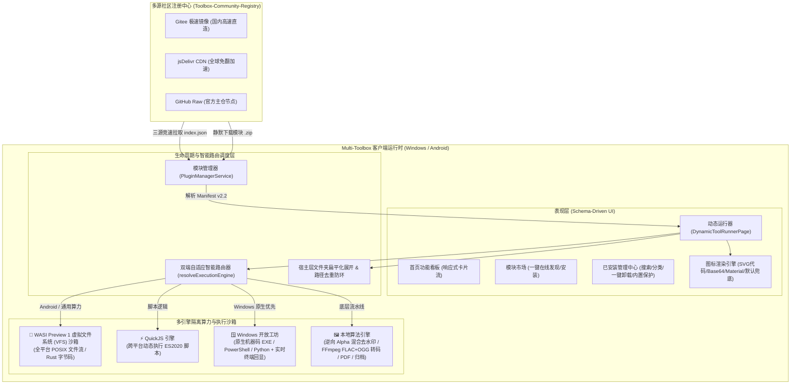

# 🛠️ Multi-Toolbox 社区功能模块（插件）全栈开发与技术架构指南 (Manifest v2.2)

> **当前规范版本**：`Manifest v2.2` (全面支持 WASI Preview 1 VFS 虚拟文件系统与双端自适应合一架构)  
> **适用对象**：核心维护人员、第三方工具开发者、系统与脚本工程师（Rust / C++ / WebAssembly / JavaScript / Python / CLI）  
> **核心哲学**：**客户端极致精简稳定，海量功能按需沙箱热插拔；100% 纯本地离线执行，全面保障用户隐私与数据安全。**

---

## 目录 (Table of Contents)

1. [系统整体架构与沙箱底座全貌](#1-系统整体架构与沙箱底座全貌)
2. [五大执行模式与运行时深度解析](#2-五大执行模式与运行时深度解析)
   - [2.1 WebAssembly (Wasm) 二进制算力与 WASI Preview 1 虚拟文件系统 (VFS) 沙箱](#21-webassembly-wasm-二进制算力与-wasi-preview-1-虚拟文件系统-vfs-沙箱)
   - [2.2 QuickJS 跨平台动态脚本沙箱](#22-quickjs-跨平台动态脚本沙箱-executiontype-quickjs)
   - [2.3 Windows 开放扩展工坊 (Native CLI / Script)](#23-windows-开放扩展工坊-executiontype-native_executable--script)
   - [2.4 🚀 双端自适应合一架构 (Dual-Adaptive: Win 原生 + Android WASM)](#24--双端自适应合一架构-dual-adaptive-win-原生--android-wasm)
   - [2.5 客户端内置原生算法与多媒体流水线](#25-客户端内置原生算法与多媒体流水线-executiontype-internal)
3. [Manifest v2.2 清单规范全字段完整参考](#3-manifest-v22-清单规范全字段完整参考)
   - [3.1 核心元数据配置](#31-核心元数据配置)
   - [3.2 图标系统完整规范 (图片限制与 SVG 矢量代码渲染)](#32-图标系统完整规范-图片限制与-svg-矢量代码渲染)
   - [3.3 动态表单组件系统 (Inputs)](#33-动态表单组件系统-inputs)
     - *文件选择器特性：Android 专有后缀容错、文件夹递归展开与符号链接防死循环*
   - [3.4 动态条件联动展示 (visibleIf)](#34-动态条件联动展示-visibleif)
   - [3.5 完整的 dual-adaptive 双 Runner 声明结构](#35-完整的-dual-adaptive-双-runner-声明结构)
4. [从零开始的实战开发教程 (4 个完整实例)](#4-从零开始的实战开发教程-4-个完整实例)
   - [实战 1：开发一个 QuickJS 文本高频词分析与多重编解码模块](#实战-1开发一个-quickjs-文本高频词分析与多重编解码模块)
   - [实战 2：开发一个 Rust 编译的 WebAssembly 极速素数筛/哈希计算模块](#实战-2开发一个-rust-编译的-webassembly-极速素数筛哈希计算模块)
   - [实战 3：开发一个 Windows 独立 CLI 音视频转码与终端回显扩展](#实战-3开发一个-windows-独立-cli-音视频转码与终端回显扩展)
   - [🌟 实战 4：开发一个双端自适应合一插件（网易云 NCM 解密器）](#-实战-4开发一个双端自适应合一插件网易云-ncm-解密器)
5. [本地开发、打包与自动化测试规范](#5-本地开发打包与自动化测试规范)
6. [社区注册中心提交与合入发布规范 (PR 流程)](#6-社区注册中心提交与合入发布规范-pr-流程)

---

## 1. 系统整体架构与沙箱底座全貌

Multi-Toolbox 采用 **“宿主容器（Host Container）+ 声明式 Schema 驱动 UI + 多引擎隔离沙箱（Sandboxed Runtimes）+ 多源分布式注册表（Registry）”** 的现代化分层架构。



### 为什么开发者无需为客户端重新发版？
1. **界面全声明化**：开发者无需编写 Flutter Widget。只需在 `manifest.json` 中以 JSON 声明输入表单（文件选择、滑块、下拉选择、联动条件等），客户端在运行时自动渲染。
2. **多沙箱直接执行**：无论是编译好的 WebAssembly 二进制还是 JS 脚本，均能在客户端沙箱中离线运行，零发版周期。
3. **双端自适应合一 (Dual-Adaptive)**：一个插件包同时容纳 Windows 原生二进制与 Android WASM 字节码，客户端根据操作系统自动选择最优执行链路，兼具极致性能与全平台便携性。
4. **安全隔离与无感更新**：模块以独立的 `.zip` 包发布与缓存。新增、更新或卸载功能，只需操作对应的模块目录，绝不影响客户端本体。

---

## 2. 五大执行模式与运行时深度解析

开发者可根据任务特点与技术栈，在 `manifest.json` 中灵活选择执行模式：

| 执行模式 (`executionType`) | 核心技术栈 | 跨平台支持 | 适用典型场景 |
| :--- | :--- | :---: | :--- |
| **`wasm` (WASI CLI / VFS)** | C / C++ / Rust / Go (`wasm32-wasip1`) | 🌐 Windows / Android 全兼容 | 密集计算、二进制流转换、音视频音频解密、大文件流式加解密 |
| **`quickjs`** | JavaScript (ES2020) | 🌐 Windows / Android 全兼容 | 纯文本分析、数据清洗、正则解析、轻量算法规则 |
| **`native_executable` / `script`** | CLI 可执行程序、PowerShell、Python | 🪟 Windows 专享 | 挂接现成大型 Windows 命令行工具（如 ffmpeg, yt-dlp, pandoc） |
| **🚀 双端自适应合一 (Dual-Adaptive)** | Win 原生 EXE + Android WASM | 🌐 双端最优解 | **强烈推荐**：Windows 跑裸机原生二进制（0.3s 直出），Android 跑 WASM 沙箱（<1s 完成） |
| **`internal`** | 客户端底层图形/音视频引擎 | 🌐 Windows / Android 全兼容 | 逆向 Alpha 混合去水印、FFmpeg 原生转码（新增 FLAC / OGG）、PDF 矢量重构 |

---

### 2.1 WebAssembly (Wasm) 二进制算力与 WASI Preview 1 虚拟文件系统 (VFS) 沙箱

在最新架构中，Multi-Toolbox 将底座升级为支持 **WASI Preview 1 规范与虚拟文件系统 (VFS)** 的高性能引擎（基于 Rust `wasm_run` 底座，预编译包含全架构原生动态库）：

#### 核心技术优势：
- **物理磁盘虚拟目录映射**：
  客户端自动将宿主主机的真实工作路径无缝挂载为沙箱内部的标准 POSIX 路径：
  - 宿主输入文件父目录 $	o$ 沙箱 `/input`
  - 宿主任务输出目录 $	o$ 沙箱 `/output` 及当前工作目录 `.`
  - 宿主临时目录 $	o$ 沙箱 `/tmp`
- **真正的流式 I/O**：
  C/C++（`fopen` / `fread` / `fwrite`）或 Rust（`std::fs::File`）编译到 `wasm32-wasip1` 目标后，标准 I/O 调用直接桥接到宿主磁盘。百兆级别音频与大型二进制文件可直接以 1MB~4MB 分块流式读写，彻底告别旧版 QuickJS/纯内存传输引发的内存暴涨与 UTF-8 乱码限制。
- **CLI 批处理全生命周期调度**：
  支持 `executionMode: "wasi_cli"`，自动寻找 `_start` 入口，支持参数占位符模板（如 `-i {input} -o {outputDir}`）与 `batchMode: true` 自动多文件流式批处理。

#### Manifest 配置结构：
```json
{
  "executionType": "wasm",
  "engineType": "wasm",
  "wasmRunner": {
    "entry": "bin/tool.wasm",
    "executionMode": "wasi_cli",
    "args": ["-i", "{input}", "-o", "{outputDir}"],
    "batchMode": true,
    "showTerminal": true
  },
  "action": {
    "handler": "wasm_universal",
    "params": {}
  }
}
```

---

### 2.2 QuickJS 跨平台动态脚本沙箱 (`executionType: "quickjs"`)

客户端内嵌轻量纯本地 QuickJS 运行时，打通了 Dart 与 JS 之间的双向宿主通信。

#### 开发特点与优势：
- **热插拔极速调试**：直接编辑 `.js` 文件，重新进入工具页面即刻生效，无需任何编译工具链。
- **标准语法支持**：完整支持 ES2020 语法（包括箭头函数、解构赋值、BigInt、Promise 等）。
- **宿主环境自动注入**：
  - UI 表单参数自动注入为全局对象 `inputs`（例如 `inputs.sourceText`、`inputs.format`）。
  - 支持 `console.log(...)`，终端面板实时捕获回显。
  - 最终结果直接以 `return` 语句返回字符串呈现给用户。

---

### 2.3 Windows 开放扩展工坊 (`executionType: "native_executable" | "script"`)

针对 Windows 桌面端的大型生产力工具与自动化运维，直接以机器码调度外部程序。

#### 开发特点与优势：
- **自由集成现有 CLI 工具**：无需重写代码，声明参数占位符模板即可调度 `.exe`。
- **多源二进制静默分发与哈希校验**：支持配置 `downloadUrls` 与 `sha256` 自动下载缺失的二进制依赖。
- **实时终端黑框控制台**：配置 `"showTerminal": true`，流式捕获标准输出与标准错误，支持一键中止进程。

---

### 2.4 🚀 双端自适应合一架构 (Dual-Adaptive: Win 原生 + Android WASM)

这是 Multi-Toolbox 极具竞争力的前沿架构。**以往开发者在兼顾多端时往往面临两难**：
- 如果只用 WASM：Android 表现优秀，但在 Windows 上由于系统过滤驱动拦截（Defender实时扫描每一次虚拟系统调用），百兆大文件处理不如原生裸机程序流畅；
- 如果只用 EXE：Android 平台完全无法运行；
- 如果拆分为两个插件：商店中充斥重复插件，用户下载和维护极其困惑。

#### 双端自适应解决方案：
开发者仅需在单个插件中**同时声明 `nativeRunner` 与 `wasmRunner`**：
```json
{
  "id": "my-tool",
  "name": "极速音频转换",
  "version": "1.0.0",
  "platforms": ["windows", "android"],
  "nativeRunner": {
    "entry": "bin/tool.exe",
    "args": ["-o", "{outputDir}", "{inputs}"]
  },
  "wasmRunner": {
    "entry": "bin/tool.wasm",
    "executionMode": "wasi_cli",
    "args": ["-i", "{input}", "-o", "{outputDir}"],
    "batchMode": true
  }
}
```

#### 客户端智能调度行为：
1. **Windows 桌面端**：检测到存在 `nativeRunner`，优先调用 `WindowsExtensionRunnerService` 运行 `bin/tool.exe`，直接以裸机多线程运行，160MB 文件实测 **0.3 秒** 秒级直出！
2. **Android 移动端**：自动无缝落入 `WasmUniversalService` 运行 `bin/tool.wasm`，在 WASI VFS 沙箱中安全隔离运行，**<1 秒** 高效转换！
3. **商店与界面呈现**：在插件商店与管理页均展示统一的 **`🚀 双端自适应`** 徽标；在运行器顶部标题栏实时显示当前生效的工作状态：
   - Windows 显示：**`🚀 Win 原生极速模式`**
   - Android 显示：**`🦀 Android Wasm 沙箱模式`**

---

### 2.5 客户端内置原生算法与多媒体流水线 (`executionType: "internal"`)

客户端内置了经过严苛优化的图形、文档与音视频流水线：
- **音视频工具箱 (`video-audio-toolbox`) v1.3.0 增强**：
  - 支持 **FLAC 原生多线程无损转码**（`-c:a flac`）。
  - 支持 **OGG (Vorbis) 高保真转码**（双重保障：首选 `libvorbis -q:a 5`，若环境缺失自动平滑回退至 FFmpeg 原生内置 `vorbis` 编码器）。
  - 文件选择器支持 `.ogg`、`.m4a`、`.flac`、`.wav`、`.mp3` 等多种格式。
- **Gemini-Banana 无损去水印**：采用逆向 Alpha 混合数学解算算法（Reverse Alpha Blending），逐像素精准解算原底色。
- **万能解压缩**：支持分卷压缩包智能串联、GBK 乱码自动探测修复与防双重嵌套展开。

---

## 3. Manifest v2.2 清单规范全字段完整参考

每个功能模块的唯一配置文件为 `manifest.json`。

### 3.1 核心元数据配置

```json
{
  "id": "my-awesome-tool",
  "name": "工具中文名称",
  "version": "1.0.0",
  "minAppVersion": "1.0.0",
  "category": "media",
  "platforms": ["windows", "android"],
  "description": "详细阐述功能与算法特性，关键词会被模块管理与市场实时检索覆盖。",
  "author": "开发者署名",
  "executionType": "wasm",
  "engineType": "wasm"
}
```

- **`id`** *(必填, String)*：模块唯一英文标识符，必须与所在文件夹名完全相同。仅允许小写字母、数字和中划线 `-`。
- **`platforms`** *(必填, Array\<String\>)*：
  - `["windows", "android"]` 或 `["universal"]`：全平台兼容（若同时声明双 runner 即为双端自适应）。
  - `["windows"]`：Windows 专享扩展。
  - `["android"]`：Android 专享。

---

### 3.2 图标系统完整规范 (图片限制与 SVG 矢量代码渲染)

#### 方案一：SVG 代码渲染模式 (`type: "code"`) —— 强烈推荐首选 🌟
直接内联纯文本 SVG 矢量 XML，缩放清晰不失真、包体仅数百字节：
```json
"icon": {
  "type": "code",
  "data": "<svg xmlns="http://www.w3.org/2000/svg" viewBox="0 0 24 24"><rect x="2" y="2" width="20" height="20" rx="5" fill="#6366F1"/><path d="M8 12h8M12 8v8" stroke="#FFFFFF" stroke-width="2" stroke-linecap="round"/></svg>"
}
```
> **安全规范**：SVG 文本大小不得超过 **64 KB**。

#### 方案二：图片模式 (`type: "image"`)
```json
"icon": {
  "type": "image",
  "data": "data:image/png;base64,iVBORw0KGgo...",
  "maxPixels": 256,
  "maxSizeBytes": 102400
}
```
> **安全限制**：图片大小不得超过 **512 KB**，分辨率建议 $\le 512 	imes 512$ 像素。超限将自动安全降级为官方拼图图标。

---

### 3.3 动态表单组件系统 (Inputs)

#### 1. 文件选择器 (`file_picker`)
```json
{
  "id": "musicFiles",
  "label": "选择待处理文件 (支持批量多选与整目录展开)",
  "type": "file_picker",
  "required": true,
  "allowMultiple": true,
  "allowedExtensions": ["ncm", "flac", "mp3"]
}
```
- **Android 端专有未知后缀安全降级**：
  在 Android 系统下，某些私有后缀（如 `.ncm`、`.qmc`、`.dat`）没有被注册到系统的 MimeTypeMap 中，直接使用 `FileType.custom` 会导致系统 SAF 选择器无响应或文件置灰。Multi-Toolbox 客户端在底层实现了智能捕获与 `FileType.any` 安全平滑降级，并在宿主层完成后缀校验，开发者无需写任何防御胶水代码！
- **文件夹扁平化展开与防环机制 (`flattenInputEntries`)**：
  若用户选择或拖拽了整个文件夹，客户端会在宿主层自动进行目录递归扫描、排除隐藏与系统垃圾文件（如 `.DS_Store`、`Thumbs.db`、`desktop.ini`），并执行规范化路径去重与符号链接防死循环保护（`followLinks: false`），将目录中的真实目标文件整齐喂给 WASI 沙箱或 CLI 批处理调度器。

#### 2. 其他输入组件
- `slider`：数值滑块（支持 `defaultValue`, `min`, `max`, `step`）。
- `select`：下拉单选（选项支持 `options: [{label, value, platforms}]`）。
- `number`：数字输入框。
- `text`：文本域输入框。

---

### 3.4 动态条件联动展示 (visibleIf)

```json
{
  "id": "bitrate",
  "label": "自定义音频码率",
  "type": "select",
  "options": [
    { "label": "320 kbps (极致音质)", "value": "320k" },
    { "label": "192 kbps (标准均衡)", "value": "192k" }
  ],
  "visibleIf": {
    "field": "format",
    "equals": "mp3"
  }
}
```

---

## 4. 从零开始的实战开发教程 (4 个完整实例)

### 🌟 实战 4：开发一个双端自适应合一插件（网易云 NCM 解密器）

本实战以官方社区上线的旗舰级插件 `ncm-audio-converter`（网易云 NCM 解密）为完整范例，展示如何开发一个兼具 Windows 原生极速性能与 Android WASM 跨平台沙箱的自适应插件。

#### 步骤 1：编写核心解密逻辑 (Rust)
在 Rust 中实现解密内核，注意：
- 避免小缓冲读写，采用 1MB~4MB 块缓冲，减少 WASI 系统调用开销；
- 预计算密钥流，避免逐字节重复异或算术；
- 遍历目录时务必严格过滤 `.`（当前目录）和 `..`（父目录），防止 Android Linux POSIX `readdir` 引发死递归。

#### 步骤 2：交叉编译双端产物
```bash
# 1. 编译 Windows 原生二进制 (x86_64 机器码)
cargo build --target x86_64-pc-windows-msvc --release
# 产物：target/x86_64-pc-windows-msvc/release/ncmdump.exe

# 2. 编译跨平台 WebAssembly 字节码 (WASI Preview 1 规范)
cargo build --target wasm32-wasip1 --release
# 产物：target/wasm32-wasip1/release/ncmdump.wasm
```

#### 步骤 3：组装目录结构
在 `plugins/ncm-audio-converter/` 下组织文件：
```text
plugins/ncm-audio-converter/
  ├── manifest.json
  ├── README.md
  └── bin/
        ├── ncmdump.exe     (约 399 KB)
        └── ncmdump.wasm    (约 362 KB)
```

#### 步骤 4：编写完整 `manifest.json`
```json
{
  "id": "ncm-audio-converter",
  "name": "网易云 NCM 解密",
  "version": "2.2.0",
  "minAppVersion": "1.0.0",
  "category": "media",
  "platforms": ["windows", "android"],
  "executionType": "wasm",
  "engineType": "wasm",
  "author": "taurusxin / 社区移植",
  "description": "【双端自适应合一】Windows 端自动调度本地原生极速程序 (0.3s 直出)，Android 端无缝运行 WASM 算力微内核沙箱 (<1s 完成)。专为网易云专属加密 NCM 格式设计，100% 还原原始无损 FLAC 或高保真 MP3 音轨，自动嵌入元数据与高清封面，支持全选批量与整目录展开。",
  "icon": {
    "type": "code",
    "data": "<svg xmlns="http://www.w3.org/2000/svg" viewBox="0 0 24 24"><defs><linearGradient id="ncmGrad" x1="0%" y1="0%" x2="100%" y2="100%"><stop offset="0%" stop-color="#E11D48"/><stop offset="100%" stop-color="#9333EA"/></linearGradient></defs><rect x="2" y="2" width="20" height="20" rx="5" fill="url(#ncmGrad)"/><circle cx="11" cy="12" r="7" fill="none" stroke="#FFFFFF" stroke-width="1.2" stroke-opacity="0.3"/><circle cx="11" cy="12" r="4.5" fill="none" stroke="#FFFFFF" stroke-width="1.2" stroke-opacity="0.5"/><circle cx="11" cy="12" r="2" fill="#FFFFFF"/><path d="M16 6v7.5a2 2 0 1 1-1.5-1.93V8h3V6h-1.5z" fill="#FFFFFF"/><rect x="15" y="14" width="7" height="6" rx="1.5" fill="#10B981"/><path d="M17 14v-1.8a1.5 1.5 0 0 1 3 0V14" fill="none" stroke="#10B981" stroke-width="1.3" stroke-linecap="round"/><circle cx="18.5" cy="17" r="0.8" fill="#FFFFFF"/></svg>"
  },
  "nativeRunner": {
    "entry": "bin/ncmdump.exe",
    "args": [
      "-o", "{outputDir}", "{inputs}"
    ],
    "showTerminal": true
  },
  "wasmRunner": {
    "entry": "bin/ncmdump.wasm",
    "executionMode": "wasi_cli",
    "args": [
      "-i", "{input}", "-o", "{outputDir}"
    ],
    "batchMode": true,
    "showTerminal": true
  },
  "inputs": [
    {
      "id": "musicFiles",
      "label": "选择待解锁的 NCM 音乐文件 (支持批量多选与整目录)",
      "type": "file_picker",
      "required": true,
      "allowMultiple": true,
      "allowedExtensions": ["ncm"]
    }
  ],
  "action": {
    "handler": "wasm_universal",
    "params": {}
  }
}
```

---

## 5. 本地开发、打包与自动化测试规范

社区注册表仓库自带本地校验与构建工具 `tools/build_registry.py`。

### 运行自动化构建与检查
在 `Toolbox-Community-Registry-Repo/` 根目录下执行：
```bash
python tools/build_registry.py
```

### 校验项清单：
1. **文件夹与 ID 一致性**：`plugins/<plugin_id>/` 目录名与 `manifest.json` 中的 `"id"` 必须完全对齐。
2. **必填元数据校验**：必须包含 `id`、`name`、`version`、`category`、`description` 字段。
3. **图标安全校验**：SVG 代码大小 $\le$ 64KB；图片数据 $\le$ 512KB。
4. **包体压缩**：脚本自动生成 `packages/<plugin_id>.zip` 并生成标准哈希。
5. **多源镜像索引聚合**：自动更新 `registry/index.json`，补充 Gitee、jsDelivr CDN 与 GitHub 直连三重下载源。

---

## 6. 社区注册中心提交与合入发布规范 (PR 流程)


### 开发者守则：
- 🟢 **纯本地执行**：严禁向任何第三方服务器私自上载用户文件、个人数据或隐私信息。
- 🟢 **包体控制**：模块包源码应当轻巧精悍。单包体积建议控制在合理范围内。
- 🟢 **尊重版权**：如实标注 `author` 与引用开源项目的许可协议（如 MIT、Apache-2.0）。

🎉 **当您的 Pull Request 合入 `main` 分支后，GitHub Actions 将自动执行多源构建，全球所有 Multi-Toolbox 用户在打开客户端「模块市场」时即可即时发现并一键安装您的作品！**
