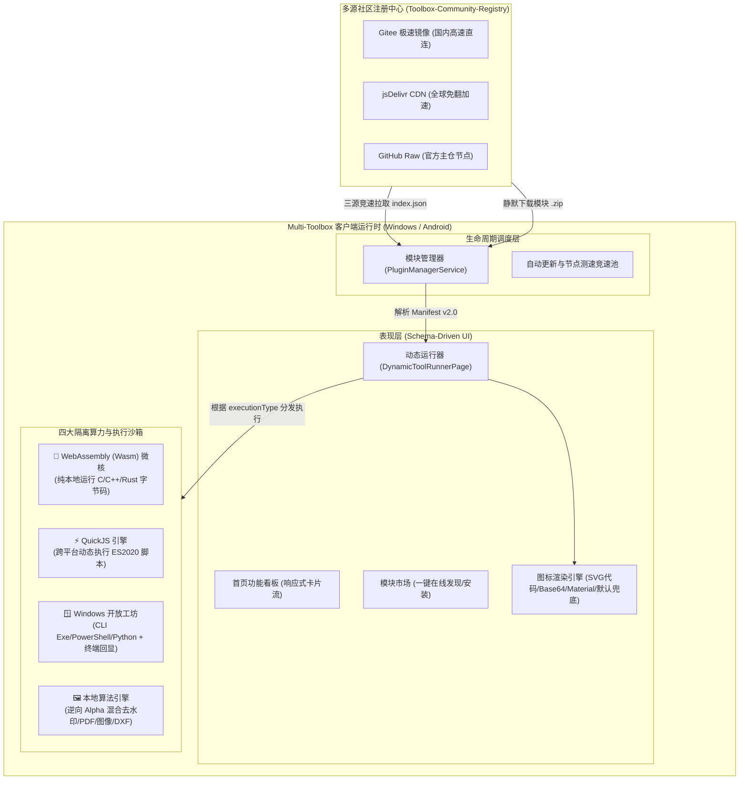

# 🛠️ Multi-Toolbox 社区功能模块（插件）全栈开发与技术架构指南 (Manifest v2.0)

> **版本**：`Manifest v2.0`  
> **适用对象**：核心维护人员、第三方工具开发者、系统与脚本工程师（Rust/C++/JS/Python/CLI）  
> **核心哲学**：**客户端极致精简稳定，海量功能按需沙箱热插拔；100% 纯本地离线执行，全面保障用户隐私与数据安全。**

---

## 目录 (Table of Contents)

1. [系统整体架构与沙箱底座全貌](#1-系统整体架构与沙箱底座全貌)
2. [四大执行模式与运行时深度解析](#2-四大执行模式与运行时深度解析)
   - [2.1 WebAssembly (Wasm) 二进制算力沙箱](#21-webassembly-wasm-二进制算力沙箱-executiontype-wasm)
   - [2.2 QuickJS 跨平台动态脚本沙箱](#22-quickjs-跨平台动态脚本沙箱-executiontype-quickjs)
   - [2.3 Windows 开放扩展工坊](#23-windows-开放扩展工坊-executiontype-native_executable--script)
   - [2.4 客户端内置原生算法流水线](#24-客户端内置原生算法流水线-executiontype-internal)
3. [Manifest v2.0 清单规范全字段完整参考](#3-manifest-v20-清单规范全字段完整参考)
   - [3.1 核心元数据配置](#31-核心元数据配置)
   - [3.2 图标系统完整规范 (图片限制与代码渲染)](#32-图标系统完整规范-图片限制与代码渲染)
   - [3.3 动态表单组件系统 (Inputs)](#33-动态表单组件系统-inputs)
   - [3.4 动态条件联动展示 (visibleIf)](#34-动态条件联动展示-visibleif)
4. [从零开始的实战开发教程 (3 个完整实例)](#4-从零开始的实战开发教程-3-个完整实例)
   - [实战 1：开发一个 QuickJS 文本高频词分析与多重编解码模块](#实战-1开发一个-quickjs-文本高频词分析与多重编解码模块)
   - [实战 2：开发一个 Rust 编译的 WebAssembly 极速素数筛/哈希计算模块](#实战-2开发一个-rust-编译的-webassembly-极速素数筛哈希计算模块)
   - [实战 3：开发一个 Windows 独立 CLI 音视频转码与终端回显扩展](#实战-3开发一个-windows-独立-cli-音视频转码与终端回显扩展)
5. [本地开发、打包与自动化测试规范](#5-本地开发打包与自动化测试规范)
6. [社区注册中心提交与合入发布规范 (PR 流程)](#6-社区注册中心提交与合入发布规范-pr-流程)

---

## 1. 系统整体架构与沙箱底座全貌

Multi-Toolbox 采用 **“宿主容器（Host Container）+ 声明式 Schema 驱动 UI + 多引擎隔离沙箱（Sandboxed Runtimes）+ 多源分布式注册表（Registry）”** 的现代化分层架构。



### 为什么开发者无需为客户端重新发版？
1. **界面全声明化**：开发者无需编写 Flutter Widget。只需在 `manifest.json` 中以 JSON 声明输入表单（文件选择、滑块、下拉选择、联动条件等），客户端在运行时自动渲染。
2. **多沙箱直接执行**：无论是 JS 脚本还是编译好的 `.wasm` 二进制，均能直接在客户端底座提供的虚拟机沙箱中离线运行，零编译步骤、零发版周期。
3. **安全隔离与无感更新**：模块以独立的 `.zip` 包发布与缓存。新增、更新或卸载功能，只需操作对应的模块目录，绝不影响客户端本体。

---

## 2. 四大执行模式与运行时深度解析

开发者可根据自己的技术栈与任务特点，在 `manifest.json` 中配置 `executionType`：

| 执行模式 (`executionType`) | 核心技术栈 | 跨平台兼容性 | 适用典型场景 |
| :--- | :--- | :---: | :--- |
| **`wasm`** | C / C++ / Rust / Go | 🌐 Windows / Android 全兼容 | 密集数学计算、密码学、音视频编解码、物理模拟、图像/音频信号处理 |
| **`quickjs`** | JavaScript (ES2020) | 🌐 Windows / Android 全兼容 | 文本处理、数据清洗、JSON/XML 转换、敏感词过滤、自动化规则运算 |
| **`native_executable` / `script`** | CLI 可执行程序、PowerShell、Python | 🪟 Windows 专享 | 挂接现成的大型工具（如 ffmpeg, yt-dlp, pandoc）、系统级自动化任务 |
| **`internal`** | 客户端内置高效算法 | 🌐 Windows / Android 全兼容 | 逆向 Alpha 混合无损去水印、图像格式压缩/缩放、PDF 矢量拆分合并、CAD DXF |

---

### 2.1 WebAssembly (Wasm) 二进制算力沙箱 (`executionType: "wasm"`)

客户端底座内置了完整的 WebAssembly 解释与执行内核，支持直接在内存沙箱中加载并运行 `.wasm` 二进制与 `.wat` 文本模块。

#### 开发特点与优势：
- **近乎原生性能**：利用 C/C++/Rust 极致的执行速度。
- **天然内存强隔离**：运行在独立的线性内存空间，不存在任何指针逃逸或系统提权风险。
- **全平台零依赖**：一次编译，在 Android（arm64-v8a、armeabi-v7a、x86_64）与 Windows 上完全一致运行。

#### Manifest 配置要点：
```json
{
  "executionType": "wasm",
  "engineType": "wasm",
  "action": {
    "handler": "wasm_runner",
    "params": {
      "wasmFile": "module.wasm",
      "entryFunction": "process_data"
    }
  }
}
```

---

### 2.2 QuickJS 跨平台动态脚本沙箱 (`executionType: "quickjs"`)

客户端底座内嵌了轻量高效的 QuickJS 引擎，并打通了 Dart 与 JS 之间的宿主双向调用通道。

#### 开发特点与优势：
- **热插拔极速调试**：直接编辑 `.js` 文件，客户端重新进入页面即刻生效，无需编译。
- **标准语法支持**：完整支持 ES2020 语法（包括箭头函数、解构赋值、BigInt、Promise 等）。
- **宿主环境注入能力**：
  - 自动将用户在 UI 表单中填写的参数注入为全局对象 `inputs`（例如 `inputs.sourceText`、`inputs.format`）。
  - 支持 `console.log(...)`，日志将流式捕获并在客户端界面或终端面板中回显。
  - 支持直接将计算结果存入返回变量或以 `return` 返回。

#### Manifest 配置要点：
```json
{
  "executionType": "quickjs",
  "engineType": "quickjs",
  "action": {
    "handler": "quickjs_runner",
    "params": {
      "scriptFile": "main.js"
    }
  }
}
```

---

### 2.3 Windows 开放扩展工坊 (`executionType: "native_executable" | "script"`)

针对 Windows 桌面端的大型生产力工具与自动化运维，Multi-Toolbox 提供了开放扩展工坊。

#### 开发特点与优势：
- **自由集成现有 CLI 工具**：无需重写代码，直接声明参数占位符模板调度 `.exe`。
- **多源二进制静默分发与哈希校验**：
  若用户本地未安装该依赖程序，工坊支持通过 `downloadUrls`（自动竞速 Gitee/jsDelivr/GitHub 源）一键静默拉取，并通过 `sha256` 确保二进制未被篡改。
- **实时终端流捕获 (Live Terminal)**：
  配置 `"showTerminal": true`，执行时界面会自动展开实时终端黑框，逐行流式捕获 Standard Output 与 Standard Error，并提供一键中止进程（Kill Switch）能力。

#### Manifest 配置要点：
```json
{
  "executionType": "native_executable",
  "platforms": ["windows"],
  "nativeRunner": {
    "entry": "bin/tool.exe",
    "args": ["-i", "{inputFile}", "-o", "{outputDir}", "--quality", "{quality}"],
    "showTerminal": true,
    "downloadUrls": {
      "github": "https://github.com/.../tool.exe",
      "gitee": "https://gitee.com/.../tool.exe"
    },
    "sha256": "3a8b...7f",
    "binSize": 10485760
  }
}
```

---

## 3. Manifest v2.0 清单规范全字段完整参考

每个功能模块的唯一核心配置文件为 `manifest.json`。

### 3.1 核心元数据配置

```json
{
  "id": "demo-tool",
  "name": "示例工具名称",
  "version": "1.0.0",
  "minAppVersion": "1.0.0",
  "category": "image",
  "platforms": ["universal"],
  "description": "模块的详细功能介绍，支持在客户端中被关键词和深度参数扫描检索。",
  "author": "开发者昵称",
  "executionType": "wasm",
  "engineType": "wasm"
}
```

- **`id`** *(必填, String)*：模块唯一英文标识符，必须与插件所在文件夹名完全一致。只允许小写字母、数字和中划线 `-`。
- **`name`** *(必填, String)*：展示在工具卡片与详情页的中文名称。
- **`version`** *(必填, String)*：语义化版本号，例如 `1.0.1`。
- **`minAppVersion`** *(可选, String)*：最低客户端版本要求，默认 `1.0.0`。
- **`category`** *(必填, String)*：分类筛选标签，可选值：`image` (图片), `media` (音视频), `text` (文本/数据), `document` (文档/CAD), `other` (实用工具/算力)。
- **`platforms`** *(必填, Array\<String\>)*：支持的平台列表，可选值：`["universal"]` (全平台通用), `["windows"]` (Win专享), `["android"]` (安卓专享)。

---

### 3.2 图标系统完整规范 (图片限制与代码渲染)

在 `Manifest v2.0` 中，图标属性全面升级，支持 **矢量 SVG 代码直接渲染**、**图片格式（严格限制大小与分辨率）** 与 **系统关键词快捷映射**：

#### 方案一：SVG 代码渲染模式 (`type: "code"`) —— 推荐首选 🌟
直接内联纯文本 SVG 矢量代码，无需额外附带图片文件，缩放清晰、体积仅几百字节：
```json
"icon": {
  "type": "code",
  "data": "<svg xmlns=\"http://www.w3.org/2000/svg\" viewBox=\"0 0 24 24\"><rect x=\"2\" y=\"2\" width=\"20\" height=\"20\" rx=\"4\" fill=\"#3B82F6\"/><path d=\"M8 12h8M12 8v8\" stroke=\"#FFFFFF\" stroke-width=\"2\" stroke-linecap=\"round\"/></svg>"
}
```
> **限制规范**：SVG 字符串大小不得超过 **64 KB**。

#### 方案二：图片模式 (`type: "image"`)
支持将图标作为 Base64 内联字符串、本地打包的相对文件路径或网络图片：
```json
"icon": {
  "type": "image",
  "data": "data:image/png;base64,iVBORw0KGgoAAAANSUhEUgAAACAAAAAgCAYAAABzenr0AAAA...",
  "maxPixels": 256,
  "maxSizeBytes": 102400
}
```
> **严格安全限制**：
> 1. **大小限制 (`maxSizeBytes`)**：图片字节大小默认不得超过 **512 KB**（可由字段进一步调小）。超限将自动拒绝加载并平滑降级。
> 2. **像素分辨率限制 (`maxPixels`)**：图片解码后的宽和高默认不得超过 **$512 \times 512$** 像素。超限将拒绝加载并平滑降级，杜绝误引入数千像素超大图导致客户端内存溢出和列表掉帧。

#### 方案三：Material 图标关键词模式 (`type: "material"`)
如果不需要自定义图形，可以直接使用系统预置的 Material 图标别名：
```json
"icon": "compress"
```
或：
```json
"icon": {
  "type": "material",
  "data": "folder_zip"
}
```
**系统常用别名列表**：
- 图片类：`image`, `compress`, `aspect_ratio`, `badge`, `watermark`, `transform`
- 媒体类：`movie`, `video`, `gif`, `motion_photo`, `download`
- 文档类：`pdf`, `doc_converter`
- 归档/数据：`folder_zip`, `zip`, `archive`, `code`, `terminal`, `memory`, `wasm`, `cpu`
- 实用类：`qr_code`, `text`

#### 优雅安全降级保障：
若未声明 `icon`，或者图片超限、损坏、代码语法错误，客户端将**统一平滑降级为官方默认功能模块图标（`Icons.extension_rounded` 拼图模块图标）**，绝不抛出任何未捕获异常。

---

### 3.3 动态表单组件系统 (Inputs)

`inputs` 数组定义了用户在界面上所能操作的控件。客户端提供了 5 种核心输入组件：

#### 1. 文件选择器 (`file_picker`)
```json
{
  "id": "inputFiles",
  "label": "选择待处理图片",
  "type": "file_picker",
  "required": true,
  "allowMultiple": true,
  "allowedExtensions": ["jpg", "jpeg", "png", "webp"]
}
```
- `allowMultiple`: `true` 为多选（批量），`false` 为单文件模式。
- `allowedExtensions`: 允许的后缀名列表（不含 `.`）。

#### 2. 滑动条 (`slider`)
```json
{
  "id": "quality",
  "label": "输出画质因子",
  "type": "slider",
  "defaultValue": 80,
  "min": 1,
  "max": 100,
  "step": 1
}
```

#### 3. 下拉单选题 (`select`)
```json
{
  "id": "algorithm",
  "label": "采样插值算法",
  "type": "select",
  "defaultValue": "lanczos",
  "options": [
    { "label": "Lanczos3 (印刷级极高清)", "value": "lanczos" },
    { "label": "Bilinear (双线性极速插值)", "value": "bilinear" },
    { "label": "Nearest (邻近保留像素风格)", "value": "nearest" }
  ]
}
```
- `options[i].platforms`: 可单独限制某个选项仅在特定平台呈现（如 `["windows"]`）。

#### 4. 数字输入框 (`number`)
```json
{
  "id": "targetWidth",
  "label": "目标宽度 (px)",
  "type": "number",
  "defaultValue": 1920,
  "min": 1,
  "max": 7680
}
```

#### 5. 文本输入框 (`text`)
```json
{
  "id": "password",
  "label": "解密密钥 (若无保护可留空)",
  "type": "text",
  "required": false,
  "defaultValue": ""
}
```

---

### 3.4 动态条件联动展示 (visibleIf)

通过在输入项中配置 `visibleIf`，可以根据其他控件的取值，动态控制当前控件的隐藏或显现（例如切换“高级设置”或切换模式）：

```json
{
  "id": "customWidth",
  "label": "自定义指定宽度",
  "type": "number",
  "visibleIf": {
    "field": "resizeMode",
    "equals": "custom_pixel"
  }
}
```

**支持的条件操作符**：
- `equals`: 当前置字段等于指定值时显现。
- `notEquals`: 当前置字段不等于指定值时显现。
- `in`: 当前置字段的值在指定集合中时显现（如 `"in": ["mode_a", "mode_b"]`）。
- `and`: 多条件组合（数组形式，所有子条件均满足时显现）。

---

## 4. 从零开始的实战开发教程 (3 个完整实例)

### 实战 1：开发一个 QuickJS 文本高频词分析与多重编解码模块

#### 第一步：建立目录
在 `plugins/` 下创建文件夹：`plugins/text-analyzer/`。

#### 第二步：编写 `manifest.json`
```json
{
  "id": "text-analyzer",
  "name": "文本词频与敏感词分析器",
  "version": "1.0.0",
  "minAppVersion": "1.0.0",
  "category": "text",
  "platforms": ["universal"],
  "executionType": "quickjs",
  "engineType": "quickjs",
  "description": "基于沙箱内嵌的高性能 JavaScript 引擎，实时分析长文本词频分布、提取高频关键词并进行敏感词过滤分析。跨平台本地离线运行。",
  "author": "社区极客",
  "icon": {
    "type": "code",
    "data": "<svg xmlns=\"http://www.w3.org/2000/svg\" viewBox=\"0 0 24 24\"><rect width=\"24\" height=\"24\" rx=\"4\" fill=\"#10B981\"/><path d=\"M4 7h16M4 12h10M4 17h14\" stroke=\"#FFFFFF\" stroke-width=\"2\" stroke-linecap=\"round\"/></svg>"
  },
  "inputs": [
    {
      "id": "sourceText",
      "label": "粘贴需要分析的文本内容",
      "type": "text",
      "required": true,
      "defaultValue": ""
    },
    {
      "id": "topN",
      "label": "提取词频 Top 排名数量",
      "type": "slider",
      "defaultValue": 10,
      "min": 3,
      "max": 50,
      "step": 1
    }
  ],
  "action": {
    "handler": "quickjs_runner",
    "params": {
      "scriptFile": "analyzer.js"
    }
  }
}
```

#### 第三步：编写核心脚本 `plugins/text-analyzer/analyzer.js`
```javascript
// inputs 对象由宿主环境自动注入
const text = (inputs.sourceText || '').trim();
const topLimit = parseInt(inputs.topN || 10, 10);

if (!text) {
  return "【错误】未提供有效的待分析文本内容！";
}

console.log("正在对 " + text.length + " 个字符进行分词统计...");

// 简单分词逻辑 (支持中英文单词与连续汉字统计)
const words = text.match(/[\u4e00-\u9fa5]{2,}|[a-zA-Z]{3,}/g) || [];
const frequencyMap = {};

for (const w of words) {
  const lower = w.toLowerCase();
  frequencyMap[lower] = (frequencyMap[lower] || 0) + 1;
}

const sortedList = Object.entries(frequencyMap)
  .sort((a, b) => b[1] - a[1])
  .slice(0, topLimit);

let result = `📊 文本深度分析报告\n`;
result += `----------------------------------------\n`;
result += `• 字符总数: ${text.length} 字符\n`;
result += `• 有效词元: ${words.length} 个\n`;
result += `• 独立词汇: ${Object.keys(frequencyMap).length} 个\n\n`;
result += `🏆 高频词汇 TOP ${topLimit} 排行榜:\n`;

sortedList.forEach(([word, count], idx) => {
  const percent = ((count / words.length) * 100).toFixed(1);
  result += ` [${idx + 1}] ${word} : 出现 ${count} 次 (${percent}%)\n`;
});

// 输出结果直接由 return 返回呈现
return result;
```

---

### 实战 2：开发一个 Rust 编译的 WebAssembly 极速素数筛/哈希计算模块

#### 第一步：编写 Rust 代码并编译
创建 Rust 项目：
```bash
cargo new --lib fast-prime-wasm
```

在 `src/lib.rs` 中：
```rust
#[no_mangle]
pub extern "C" fn count_primes(limit: u32) -> u32 {
    if limit < 2 {
        return 0;
    }
    let mut is_prime = vec![true; (limit + 1) as usize];
    is_prime[0] = false;
    is_prime[1] = false;
    
    let mut count = 0;
    let mut p = 2;
    while p * p <= limit {
        if is_prime[p as usize] {
            let mut i = p * p;
            while i <= limit {
                is_prime[i as usize] = false;
                i += p;
            }
        }
        p += 1;
    }
    
    for i in 2..=limit {
        if is_prime[i as usize] {
            count += 1;
        }
    }
    count
}
```

编译生成跨平台 `.wasm` 二进制：
```bash
cargo build --target wasm32-unknown-unknown --release
# 生成的 target/wasm32-unknown-unknown/release/fast_prime_wasm.wasm
```

#### 第二步：组装模块目录
在 `plugins/fast-prime/` 目录下放置：
- `manifest.json`
- `fast_prime.wasm`

```json
{
  "id": "fast-prime",
  "name": "极速埃氏素数筛算力模块",
  "version": "1.0.0",
  "category": "other",
  "platforms": ["universal"],
  "executionType": "wasm",
  "engineType": "wasm",
  "description": "基于 Rust 编译的原生 WebAssembly 模块，可在沙箱中秒级完成上千万级数字范围内的素数统计计算。",
  "author": "Rust 算力玩家",
  "icon": {
    "type": "code",
    "data": "<svg xmlns=\"http://www.w3.org/2000/svg\" viewBox=\"0 0 24 24\"><rect width=\"24\" height=\"24\" rx=\"4\" fill=\"#6366F1\"/><path d=\"M7 11h2v5H7zm8-4h2v9h-2zm-4 2h2v7h-2z\" fill=\"#FFFFFF\"/></svg>"
  },
  "inputs": [
    {
      "id": "limitRange",
      "label": "计算上限 (例如 10,000,000)",
      "type": "number",
      "required": true,
      "defaultValue": 1000000,
      "min": 10,
      "max": 100000000
    }
  ],
  "action": {
    "handler": "wasm_runner",
    "params": {
      "wasmFile": "fast_prime.wasm",
      "entryFunction": "count_primes"
    }
  }
}
```

---

### 实战 3：开发一个 Windows 独立 CLI 音视频转码与终端回显扩展

```json
{
  "id": "ffmpeg-audio-extractor",
  "name": "FFmpeg 高清音频极速分离器",
  "version": "1.0.0",
  "category": "media",
  "platforms": ["windows"],
  "executionType": "native_executable",
  "description": "【Windows 专享工坊】调用专业命令行多媒体工具，从各类视频文件中以无损质量直接提取原始音轨流，配备实时命令行终端输出。",
  "author": "Media Work",
  "icon": "movie",
  "nativeRunner": {
    "entry": "ffmpeg.exe",
    "args": [
      "-y",
      "-i", "{sourceVideo}",
      "-vn",
      "-c:a", "{audioCodec}",
      "{outputDir}/extracted_audio.{audioFormat}"
    ],
    "showTerminal": true
  },
  "inputs": [
    {
      "id": "sourceVideo",
      "label": "选择源视频文件",
      "type": "file_picker",
      "required": true,
      "allowMultiple": false,
      "allowedExtensions": ["mp4", "mkv", "mov", "flv", "avi"]
    },
    {
      "id": "audioFormat",
      "label": "输出音频格式",
      "type": "select",
      "defaultValue": "mp3",
      "options": [
        { "label": "MP3 高兼容格式 (320kbps)", "value": "mp3" },
        { "label": "FLAC 无损音频格式", "value": "flac" },
        { "label": "AAC 高压缩率格式", "value": "aac" }
      ]
    }
  ]
}
```

---

## 5. 本地开发、打包与自动化测试规范

社区注册表仓库自带了自动化检查和编译脚本 `tools/build_registry.py`。

### 运行自动化构建与检查
在 `community_registry_repo/` 根目录下执行：
```bash
python tools/build_registry.py
```

### 校验规则清单：
1. **文件夹与 ID 强一致性**：`plugins/<plugin_id>/` 目录名必须与 `manifest.json` 中的 `"id"` 完全相同。
2. **必填元数据校验**：必须包含 `id`、`name`、`version`、`category`、`description` 字段。
3. **图标安全规范校验**：
   - 若 `icon` 为代码渲染，SVG 代码长度不得超过 64KB。
   - 若 `icon` 为图片模式，Base64 数据或文件字节不得超过 512KB（且像素限制建议 $\le$ 512px）。
4. **包体压缩**：脚本自动为每个模块生成纯净的 `packages/<plugin_id>.zip`，并计算 MD5、SHA256 和字节大小。
5. **多源镜像索引聚合**：自动更新 `registry/index.json`，补充 Gitee、jsDelivr CDN 与 GitHub 直连三重下载源。

---

## 6. 社区注册中心提交与合入发布规范 (PR 流程)

百宝箱完全秉承开源社区共建共享精神，欢迎任何人向官方仓库提交实用的新模块！


### 提交要求与安全准则：
- 🟢 **纯本地执行原则**：严禁向任何未经用户授权的第三方服务器私自回传数据、文件或环境信息。
- 🟢 **包体控制**：模块包源码应当轻巧精悍。大于 50MB 的独立外部二进制程序请通过 `downloadUrls` 配置远程静默拉取，切勿直接将大二进制提交入 Git。
- 🟢 **版权与原创**：请在清单中如实标注 `author`。若引用开源算法或工具，请注明上游协议。

🎉 **当您的 Pull Request 合入 `main` 分支后，GitHub Actions 将自动触发多镜像构建同步，全球所有 Multi-Toolbox 用户在打开客户端「模块市场」时即可即时发现并一键安装您的作品！**
